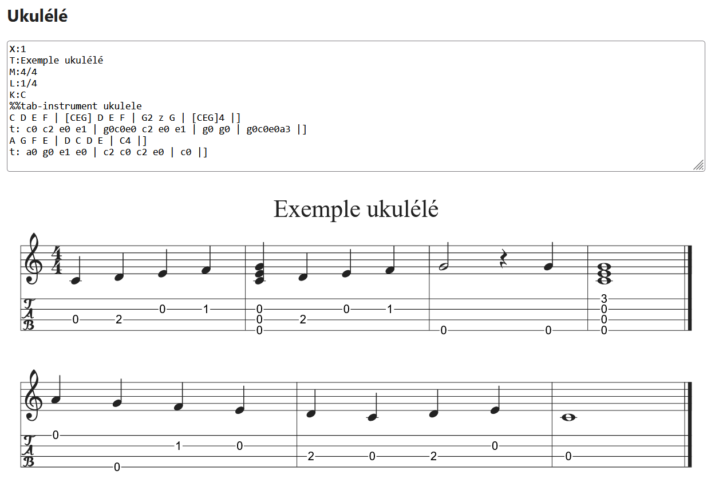
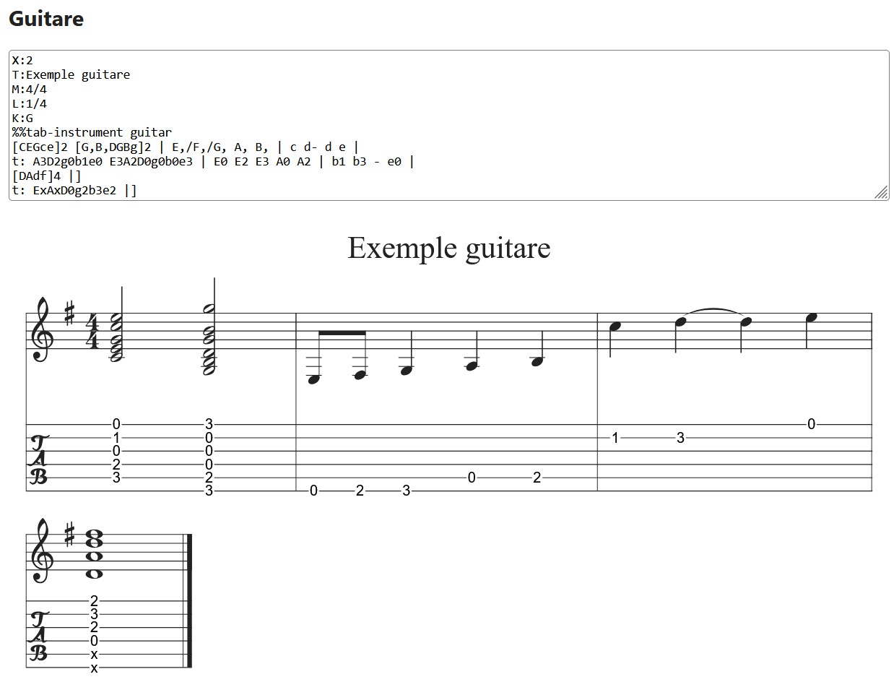

# CustomAbcTabPlugin

Explicit, hand-written guitar and ukulele tablature for [abcjs](https://github.com/paulrosen/abcjs).

abcjs can draw tablature, but it picks the fingering itself, and the result is often not what a player would use. This plugin lets you write the exact string and fret for each note in a `t:` line under the music. abcjs still lays out the TAB staff; the plugin replaces its numbers with yours.

Tested with **abcjs 6.7.2**.

## Example

```abc
X:1
M:4/4
L:1/4
K:C
%%tab-instrument ukulele
C D E F | [CEG] D E F |
t: c0 c2 e0 e1 | g0c0e0 c2 e0 e1 |
```



## Installation

1. Download `abcjs-basic-min.js` version 6.7.2 (for example from
   `https://cdn.jsdelivr.net/npm/abcjs@6.7.2/dist/abcjs-basic-min.js`)
   and put it in:

   ```
   vendor/abcjs/abcjs-basic-min.js
   ```

   This folder is ignored by git. If the file is missing, `index.html` falls back to the jsDelivr CDN.

2. Serve the folder over HTTP (the plugin is an ES module, so `file://` does not work), then open `index.html`.

## Usage

```html
<script src="vendor/abcjs/abcjs-basic-min.js"></script>
<div id="paper"></div>
<script type="module">
  import { CustomAbcTabPlugin } from './CustomAbcTabPlugin.js';

  const plugin = new CustomAbcTabPlugin(window.ABCJS, { instrument: 'guitar' });
  const { tunes, warnings } = plugin.render('paper', abcText, { responsive: 'resize' });
</script>
```

`render(container, abc, abcjsOptions)` takes the same options as `ABCJS.renderAbc`. The plugin sets `add_classes` and `tablature` itself.

### Options

| Option        | Default    | Description |
|---------------|------------|-------------|
| `instrument`  | `'guitar'` | `'guitar'` or `'ukulele'`. Used when the tune has no `%%tab-instrument` directive. |
| `label`       | `''`       | Label printed before the TAB staff (abcjs replaces `%T` with the tuning). |
| `fontScale`   | `0.85`     | Factor applied to abcjs's tab font size (11). |
| `fontSize`    | –          | Fixed font size; takes priority over `fontScale`. |
| `fontFamily`  | abcjs font | Font for the fret numbers. |
| `background`  | `'#fff'`   | Colour of the box behind each number that hides the string line. Use `'none'` to disable it. |
| `warn`        | `true`     | Log warnings to the console. |

### Lower-level API

To use the plugin with your own rendering code (for example `ABCJS.Editor`):

```js
const prepared = plugin.prepare(abc);            // { abc, instrument, tabLines, warnings }
const params   = plugin.abcjsParams(prepared);   // { add_classes, tablature }
const tunes    = ABCJS.renderAbc(el, prepared.abc, { ...myOptions, ...params });
const warnings = plugin.apply(tunes[0], prepared);
```

## `t:` syntax

- Put the `t:` line right under the music line it describes. `%t:` also works and keeps the file valid for other ABC tools.
- Write **one token per note or chord**, in order. Rests do not take a token.
- A token is one or more **string + fret** pairs written together:
  - guitar strings, low to high: `E A D g b e`. `G` and `B` are accepted for `g` and `b`. `E` (low) and `e` (high) are different strings.
  - ukulele strings: `g c e a` (case does not matter).
  - fret: a number (`0`, `3`, `12`) or `x` for a muted string.
  - examples: `c0`, `g0c0e0a3`, `A3D2g0b1e0`, `ExAxD0g2b3e2`.
- `-` or `.` means "write nothing for this note" (useful for the second note of a tie).
- Bar lines (`|`, `||`, `|]`, `:|`, …) are optional but recommended. When the `t:` line has the same number of measures as the music, tokens are matched measure by measure, so one mistake does not shift the rest of the line.

Set the instrument in the tune header:

```abc
%%tab-instrument guitar
```

The guitar demo shows full chords, muted strings (`x`) and a tied note skipped with `-`:



## How it works

1. **Prepare**: `t:` lines and `%%tab-instrument` are read, then replaced by a comment of the same length so abcjs character positions (`startChar`/`endChar`) stay correct.
2. **Render**: abcjs is called with its native tablature (guitar, or a 4-string instrument tuned GCEA for ukulele). This reserves vertical space and draws the string lines, the TAB clef and bar lines.
3. **Apply**: abcjs's computed numbers are removed. Each token is drawn at the centre of its note head, on the matching string line. The numbers go inside abcjs's own SVG groups, so click selection and highlighting still work. The added `<text>` elements have the classes `abcjs-tab-number abcjs-custom-tab` for styling.

## Warnings

`render()` returns a `warnings` array, also logged to the console, for:

- an unknown string or an unreadable token;
- a different number of tokens and notes in a measure;
- a different number of measures in the `t:` line and the music (matching then falls back to note by note);
- a `t:` line with no music line above it.

## Limitations

- One tune (`X:`) per `render()` call.
- Tablature covers only the first voice of the first staff.
- Grace notes are ignored.
- Not yet tested with `ABCJS.Editor`.

## Files

```
CustomAbcTabPlugin.js   the plugin (ES module)
index.html              live, editable ukulele and guitar demo
docs/images/            screenshots used in this README
vendor/abcjs/           put abcjs-basic-min.js here (git-ignored)
```
